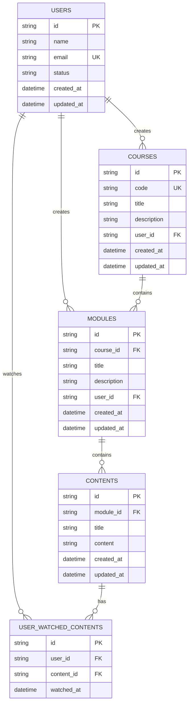

# Gerenciamento de Cursos On-line

Projeto acadêmico desenvolvido para a disciplina de Desenvolvimento Back-end. O sistema permite gerenciar usuários, cursos, módulos e conteúdos, registrar aulas assistidas e consultar relatórios.

## Funcionalidades

- Cadastro, consulta, edição e exclusão de usuários, cursos, módulos e conteúdos.
- Identificação do usuário responsável pela criação de cursos e módulos.
- Registro de conteúdos assistidos por usuário, com controle de duplicidade.
- Cinco relatórios com consultas SQL.
- Interface web, documentação Swagger e coleção de requisições para o Postman.

## Tecnologias

| Camada | Tecnologias |
| --- | --- |
| Back-end | Node.js, TypeScript e Express |
| Banco de dados | PostgreSQL |
| Acesso ao banco e migrations | Prisma |
| Front-end | HTML, CSS e JavaScript |
| Documentação da API | Swagger / OpenAPI e Postman |
| Execução em contêineres | Docker e Docker Compose |

## Executar com Docker

Instale o Git e o Docker Desktop. Abra o Docker Desktop e aguarde o mecanismo do Docker iniciar.

Clone o repositório e entre na pasta do projeto.

```bash
git clone https://github.com/Douglas715/Projetos-Profissional.git
cd Projetos-Profissional
docker compose up --build -d
```

Se você já tem o projeto no computador, execute o último comando dentro da pasta que contém o arquivo `compose.yaml`.

O Compose cria o PostgreSQL local, aplica as migrations, insere os dados de exemplo e inicia a aplicação. As configurações desse banco estão no próprio `compose.yaml`.

| Recurso | Endereço |
| --- | --- |
| Sistema | http://localhost:3000 |
| Swagger | http://localhost:3000/api-docs/ |

Para consultar o estado dos contêineres e acompanhar os registros da aplicação, use os comandos abaixo.

```bash
docker compose ps
docker compose logs -f app
```

Para parar os contêineres, execute `docker compose down`. Os dados ficam armazenados no volume `course_data`.

## Executar com Node.js

Tenha o Node.js 24 e um banco PostgreSQL disponíveis. Na pasta do projeto, instale as dependências.

```bash
npm ci
```

Copie `.env.example` para `.env`. No PowerShell, use `Copy-Item .env.example .env`.

Preencha as variáveis de conexão no `.env`.

| Variável | Finalidade |
| --- | --- |
| `DATABASE_URL` | Conexão usada pela aplicação |
| `DIRECT_URL` | Conexão usada pelas migrations |
| `PORT` | Porta da aplicação, com valor padrão 3000 |
| `HOST` | Endereço de escuta, com valor padrão 127.0.0.1 |

Em um PostgreSQL local, `DATABASE_URL` e `DIRECT_URL` podem usar a mesma URL. Para um banco hospedado, utilize as conexões fornecidas pelo serviço. O arquivo `.env` contém as credenciais e está incluído no `.gitignore`.

Prepare o banco e inicie o servidor.

```bash
npm run db:generate
npm run db:migrate
npm run db:seed
npm start
```

| Comando | Finalidade |
| --- | --- |
| `npm run dev` | Inicia o servidor com reinicialização automática |
| `npm run check` | Verifica os tipos do TypeScript |
| `npm run db:generate` | Gera o cliente Prisma |
| `npm run db:migrate` | Aplica as migrations pendentes |
| `npm run db:seed` | Insere os dados de exemplo |

## Organização do projeto

| Arquivo ou pasta | Responsabilidade |
| --- | --- |
| `src/server.ts` | Configuração do Express, arquivos estáticos, Swagger e tratamento de erros |
| `src/Routes/management.routes.ts` | Rotas de usuários, cursos, módulos, conteúdos e aulas assistidas |
| `src/Routes/report.routes.ts` | Rotas dos relatórios |
| `src/controllers/report.controller.ts` | Consultas SQL dos relatórios |
| `src/db.ts` | Cliente Prisma |
| `src/swagger.ts` | Especificação OpenAPI |
| `prisma/schema.prisma` | Modelos e relacionamentos do banco |
| `prisma/migrations/` | Histórico de alterações do banco |
| `prisma/seed.ts` | Dados de exemplo |
| `public/` | Interface em HTML, CSS e JavaScript |
| `CourseManagement.postman_collection.json` | Coleção de requisições do Postman |
| `Dockerfile` e `compose.yaml` | Configuração dos contêineres |

## Modelo de dados



A tabela `user_watched_contents` relaciona usuários e conteúdos assistidos. A combinação de `user_id` com `content_id` é única, impedindo registros repetidos da mesma aula para o mesmo usuário.

O cadastro pode ser feito em etapas, criando primeiro o curso, depois seus módulos e conteúdos. A exclusão de um registro também remove os registros dependentes por meio das chaves estrangeiras com exclusão em cascata.

A API acessa o banco pelo back-end. A migration de RLS habilita a segurança em nível de linha nas tabelas da aplicação. Em uma instalação no Supabase, a conexão do back-end deve usar uma função de banco com as permissões adequadas.

## Rotas da API

As quatro entidades usam os caminhos `/users`, `/courses`, `/modules` e `/contents`.

| Método | Caminho | Operação |
| --- | --- | --- |
| `GET` | Caminho da entidade | Lista os registros |
| `POST` | Caminho da entidade | Cadastra um registro |
| `GET` | Caminho da entidade seguido de `/:id` | Consulta um registro pelo ID |
| `PATCH` | Caminho da entidade seguido de `/:id` | Atualiza os campos informados |
| `DELETE` | Caminho da entidade seguido de `/:id` | Exclui um registro |
| `PUT` | `/users/:userId/watched/:contentId` | Registra uma aula assistida |

Por exemplo, `GET /courses` lista os cursos e `GET /courses/:id` consulta um curso específico. Os campos dos cadastros podem ser consultados e testados no Swagger.

## Relatórios

| Método e rota | Resultado |
| --- | --- |
| `GET /reports/users-most-courses` | Usuários ordenados pela quantidade de cursos criados |
| `GET /reports/course-most-contents` | Curso com a maior quantidade de conteúdos |
| `GET /reports/courses-metrics` | Cursos com o total de módulos e conteúdos |
| `GET /reports/contents-with-course` | Conteúdos acompanhados do nome do curso |
| `GET /reports/watched-content/:contentId` | Usuários que assistiram ao conteúdo informado |

Para consultar os usuários que assistiram à aula de ID `2`, acesse `/reports/watched-content/2`. As consultas estão em `src/controllers/report.controller.ts`.

## Dados de exemplo

Em um banco vazio, o seed cria cinco usuários, cinco cursos, doze módulos, quarenta e um conteúdos e cinco registros de aulas assistidas.

| Curso | Módulos | Conteúdos por módulo | Total de conteúdos |
| --- | --- | --- | --- |
| Node.js Basics | 5 | 3 | 15 |
| React Basics | 3 | 5 | 15 |
| PostgreSQL Basics | 2 | 4 | 8 |
| Git Basics | 1 | 2 | 2 |
| Web Basics | 1 | 1 | 1 |

A aula de ID `2` permite demonstrar o relatório de conteúdos assistidos. O seed também reconhece os usuários e módulos dos dados antigos do projeto para reaproveitar esses cadastros.

## Testar com Postman

Importe `CourseManagement.postman_collection.json` no Postman e confira a variável `baseUrl`, que deve apontar para `http://localhost:3000`. A coleção contém 26 requisições para testar os cadastros, as consultas e os relatórios.

## Verificações realizadas

A aplicação foi iniciada com Docker Compose e PostgreSQL local. Foram verificados os quatro CRUDs pela API, os cinco relatórios, as validações de entrada, as restrições de unicidade e o registro repetido de aulas assistidas. Também foram conferidos os tipos do TypeScript e a geração do cliente Prisma.
