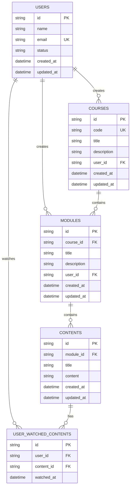

# Course Management

Academic project for the Back-end Development course. The application uses Node.js, TypeScript, Express, Prisma and PostgreSQL. The interface uses HTML, CSS and JavaScript.

## Run with Docker

With Docker Desktop running, execute `docker compose up --build` in the project folder. This creates a local PostgreSQL database, applies migrations, inserts demo records and starts the application at http://localhost:3000. Swagger is at http://localhost:3000/api-docs. This option supplies its own database settings.

Stop the application with `docker compose down`. The database remains in the named volume. The local database uses the example credentials declared in `compose.yaml`.

## Run locally

1. Install Node.js 24 and have an empty PostgreSQL database available.
2. Run `npm ci`.
3. Copy `.env.example` to `.env` and set `DATABASE_URL` and `DIRECT_URL`. Both can use the same URL on a local PostgreSQL server. If the project already has an .env file, keep its settings.
4. Run `npm run db:generate`, then `npm run db:migrate` to create the tables.
5. Run `npx prisma db seed` to insert the demo records.
6. Run `npm start` and open http://localhost:3000. Use `npm run dev` for automatic restart and `npm run check` to check TypeScript.

Swagger is available at http://localhost:3000/api-docs. Import `CourseManagement.postman_collection.json` in Postman.

## Data model

Each user and content pair can appear once in the watch history. A course or module can be saved before its child records are added. Deleting a record also deletes its dependent records through foreign keys.

The application connects through the backend database role. On Supabase, row-level security protects the tables from direct access through the public Data API. Use the database connection string in the backend environment.

## API

| Method | Path | Action |
| --- | --- | --- |
| GET, POST | `/users`, `/courses`, `/modules`, `/contents` | List or create records |
| GET, PATCH, DELETE | Any of the four paths above followed by `/:id` | Find, update or delete a record |
| PUT | `/users/:userId/watched/:contentId` | Mark a lesson as watched |
| GET | `/reports/users-most-courses` | List users by number of courses |
| GET | `/reports/course-most-contents` | Find the course with the most lessons |
| GET | `/reports/courses-metrics` | Count modules and lessons by course |
| GET | `/reports/contents-with-course` | List lessons with course names |
| GET | `/reports/watched-content/2` | List users who watched the demo lesson with ID 2 |

The report queries are in `src/controllers/report.controller.ts`. The seed creates five users, five courses and five watch records, with at least five modules and contents overall. The first three demo courses have 5, 3 and 2 modules, and 3, 5 and 4 contents per module, respectively. The first course has a demo content with ID `2`.
